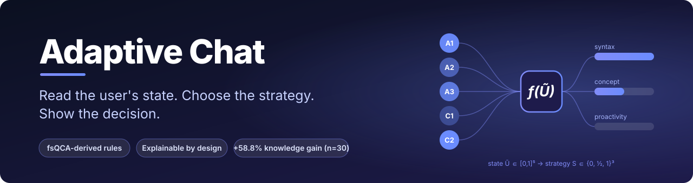
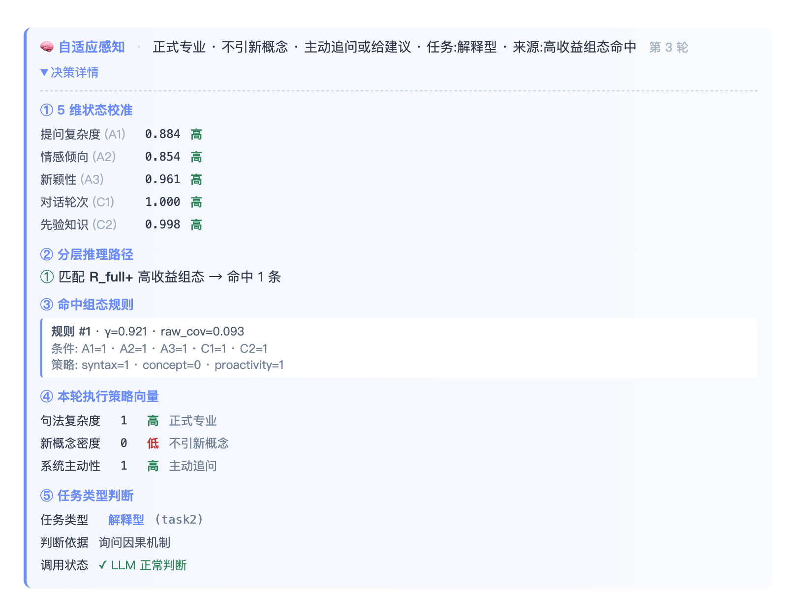
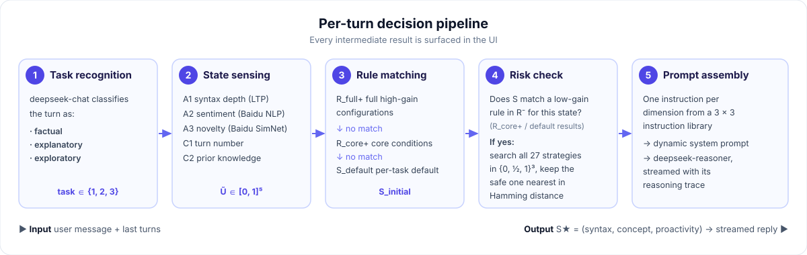
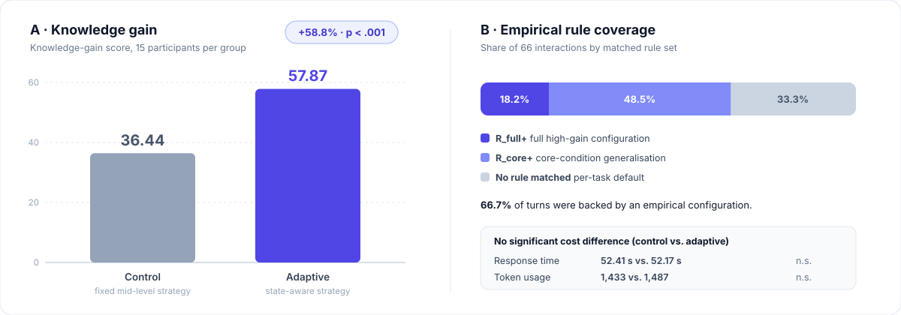

<p align="center">
  
</p>

<p align="center">
  <a href="LICENSE"></a>
  
  
  
  
</p>

<p align="center">
  <a href="#abstract">Abstract</a> ·
  <a href="#method">Method</a> ·
  <a href="#transparent-decisions">Transparent decisions</a> ·
  <a href="#empirical-results">Results</a> ·
  <a href="#getting-started">Getting started</a> ·
  <a href="#limitations">Limitations</a> ·
  <a href="#citation">Citation</a>
</p>

---

## Abstract

Large language models answer every user in the same register, regardless of whether the user is confused, curious or already expert. **Adaptive Chat** is a research harness that closes this gap. Before each reply, a lightweight decision layer (i) recognises the *task context* of the turn, (ii) measures the user's *state* along five dimensions, (iii) selects a *response strategy* by matching that state against rules mined from a controlled experiment with fuzzy-set Qualitative Comparative Analysis (fsQCA), and (iv) vetoes strategies that the same experiment showed to be low-yield for that state. The chosen strategy is compiled into plain-language instructions for the LLM.

Two properties set it apart from prompt-tuning or black-box personalisation:

- **Empirically grounded.** Strategies come from configurations observed in a 30-participant randomised study, where the adaptive group achieved a **58.8% higher knowledge gain** than a fixed-strategy control (*p* < .001) at no significant cost in latency or tokens.
- **Fully inspectable.** The calibrated state, the rule that fired, the risk check and the final strategy are rendered in the chat UI on every turn. Nothing happens off-screen.

<p align="center">
  
  <br>
  <sub><b>Figure 1.</b> The per-turn decision card, rendered by the app's own code from a real engine run (turn 3, explanatory task, R_full+ rule matched). The product UI is in Chinese; see the <a href="#reading-the-card">gloss</a> below.</sub>
</p>

## Why this is not a prompt wrapper

| | Typical LLM front-end | Adaptive Chat |
|---|---|---|
| Response style | One fixed system prompt | Re-selected every turn from the user's state |
| Source of the policy | Hand-written intuition | fsQCA configurations from a randomised experiment |
| Treatment of context | Ignored | Three task contexts, each with its own calibration anchors, rules and default |
| Known failure modes | Not modelled | Low-gain state–strategy pairs (R⁻) are explicitly vetoed |
| Observability | Opaque | Every intermediate quantity is shown to the user |
| Fallbacks | None | Layered: `R_full+` → `R_core+` → `S_default`, plus a safe-strategy search |

## Method

<p align="center">
  
  <br>
  <sub><b>Figure 2.</b> The per-turn decision pipeline.</sub>
</p>

### 1. Task recognition

A short `deepseek-chat` call (temperature 0.1, sees the current message and the last two user turns) assigns the turn to one of three task contexts. Each context has a characteristic failure mode, which is why each gets its own policy:

| Context | User intent | Characteristic failure mode |
|---|---|---|
| `task1` Factual | Look up a fact or number | Information insufficiency: the system under-supplies facts |
| `task2` Explanatory | Understand a cause, mechanism or relation | Cognitive inertia: shallow question, shallow answer |
| `task3` Exploratory | Open-ended judgement or decision support | Information overload: too much output hurts |

The classifier is re-run every turn, so topics can shift mid-conversation. On any failure it falls back to `task2`, and the UI says so.

### 2. State sensing and fuzzy-set calibration

Five signals describe the user at turn *t*:

| Symbol | Dimension | Measured by |
|---|---|---|
| A1 | Syntactic complexity | Maximum dependency-tree depth of the message ([LTP](https://github.com/HIT-SCIR/ltp)) |
| A2 | Sentiment | Positive-class probability ([Baidu NLP](https://cloud.baidu.com/product/nlp) `sentimentClassify`) |
| A3 | Novelty | 1 − SimNet similarity to the user's last three messages (neutral 0.5 on turn 1) |
| C1 | Dialogue stage | Turn number |
| C2 | Prior knowledge | Low on turn 1, high afterwards (see [Limitations](#limitations)) |

Each raw value $u_j$ is mapped to a fuzzy membership $c_j \in [0,1]$ with Ragin's direct log-odds calibration, using task-specific anchors for non-membership ($\theta_n$, 5%), the crossover point ($\theta_c$, 50%) and full membership ($\theta_f$, 95%):

$$
c_j = \frac{e^{\ln 19 \cdot r_j}}{1 + e^{\ln 19 \cdot r_j}},
\qquad
r_j =
\begin{cases}
\dfrac{u_j - \theta_c}{\theta_f - \theta_c} & u_j \ge \theta_c 
\dfrac{u_j - \theta_c}{\theta_c - \theta_n} & u_j < \theta_c
\end{cases}
$$

The result is the calibrated state vector $\tilde U_t = (c_1, \dots, c_5) \in [0,1]^5$.

### 3. Strategy space and rule base

A strategy is a point in $\mathcal{S} = \{0, 0.5, 1\}^3$ over three dimensions (low / medium / high):

| Dimension | 0 (low) | 0.5 (medium) | 1 (high) |
|---|---|---|---|
| **Syntax** | Short sentences, steps or bullets | Clear, natural prose | Formal, multi-clause argumentation |
| **Concept density** | Only concepts already in play | A little background when needed | New concepts and perspectives, clearly linked |
| **Proactivity** | Stop after answering | Follow up only if the answer is incomplete | End with a probing question or next step |

The rule base, mined with fsQCA, contains three sets per task context. Each rule is $R_i = (C_i, S_i, \gamma_i)$: a configuration of conditions, the strategy it supports, and its consistency.

| Set | Meaning | Rules (factual / explanatory / exploratory) |
|---|---|---|
| $R^{+}_{\text{full}}$ | Full configurations associated with high knowledge gain | 6 / 5 / 3 |
| $R^{+}_{\text{core}}$ | Core conditions of those configurations (parsimonious solutions) | 3 / 3 / 1 |
| $R^{-}$ | Configurations associated with low knowledge gain (risk rules) | 6 / 8 / 6 |

A rule matches when every specified condition agrees with the user's state. A condition value of 1 requires $c_j \ge 0.5$, 0 requires $c_j \le 0.5$, and unspecified conditions impose no constraint:

$$
\delta(c, u) = \mathbb{1}\big[\,|c - u| \le 0.5\,\big],
\qquad
\operatorname{Match}(C, \tilde U) = \prod_{j} \delta(c_j, \tilde u_j)
$$

### 4. Hierarchical selection and risk check

1. Collect matching rules in $R^{+}_{\text{full}}$. If any exist, use the strategy of the one with the highest $\gamma$. This result is final.
2. Otherwise, do the same over $R^{+}_{\text{core}}$.
3. Otherwise, use the per-task default $S_{\text{default}}$.
4. For results from steps 2 and 3, check $S_{\text{init}}$ against the risk rules. If some $R_k \in R^{-}$ matches the current state with $S_k = S_{\text{init}}$, build the safe set and move to its nearest member under Hamming distance:

$$
S_{\text{safe}} = \{ S \in \mathcal{S} \mid \nexists R_k \in R^{-} : \operatorname{Match}(C_k, \tilde U) = 1 \wedge S_k = S \},
\qquad
S^{\star} = \arg\min_{S \in S_{\text{safe}}} d_H(S, S_{\text{init}})
$$

If $S_{\text{safe}}$ is empty, the system falls back to $S_{\text{default}}$.

### 5. Prompt assembly

Each of the three strategy values selects one instruction from a 3 × 3 library. The three instructions are concatenated into the system prompt for `deepseek-reasoner`, which is streamed along with its reasoning trace. The prompt also tells the model not to mention or hint at these rules, so replies read naturally.

## Transparent decisions

Before each answer the app renders one card. The top line is a one-sentence summary; the collapsible body shows the full trail. The summary and the body are derived from the same `strategy_meta` and `strategy` objects, so they cannot contradict each other.

### Reading the card

| Section in Figure 1 | Meaning |
|---|---|
| 5-dimension state calibration | Calibrated memberships for A1 complexity, A2 sentiment, A3 novelty, C1 dialogue stage, C2 prior knowledge, with a high / mid / low tag |
| Layered reasoning path | Which rule set produced the strategy (`R_full+`, `R_core+`, default) and whether the risk check passed or triggered a safe-strategy search |
| Matched configuration rules | The rule(s) that fired, with consistency γ and raw coverage |
| Strategy vector for this turn | Final (syntax, concept, proactivity) values and what they mean in words |
| Task-type judgement | Recognised task context, a ≤ 12-character rationale, and whether the classifier succeeded or fell back |

## Empirical results

<p align="center">
  
  <br>
  <sub><b>Figure 3.</b> Randomised controlled experiment (<i>n</i> = 30; 15 adaptive, 15 control) of the research prototype that this repository generalises.</sub>
</p>

| Outcome | Control (fixed 0.5/0.5/0.5) | Adaptive | Result |
|---|---|---|---|
| Knowledge gain (mean) | 36.44 | **57.87** | **+58.8%**, *p* < .001 |
| Response time | 52.41 s | 52.17 s | no significant difference |
| Token usage | 1,433 | 1,487 | no significant difference |
| Turns backed by an empirical rule | n/a | 66.7% of 66 interactions | `R_full+` 18.2%, `R_core+` 48.5% |

The gain therefore comes from *which* strategy is chosen, not from longer outputs.

## From prototype to open conversation

The experiment used a controlled prototype. This repository removes the scaffolding that only made sense inside an experiment:

| | Research prototype | This repository |
|---|---|---|
| Task context | Participant picks one of three preset tasks | Recognised automatically every turn; topics can change mid-chat |
| Prior knowledge (C2) | Scored from an uploaded mind map | Turn 1 = low, later turns = high |
| Group assignment, e-mail delivery, experiment logs | Present | Removed |
| Multi-session sidebar, streamed reasoning trace | Present | Kept |

## Getting started

**Requirements:** Python 3.10+, a [DeepSeek API](https://platform.deepseek.com/) key, a [Baidu AI Cloud NLP](https://cloud.baidu.com/product/nlp) application (App ID, API Key, Secret Key), and internet access on first run (LTP downloads its weights from Hugging Face).

```bash
git clone https://github.com/GlucoseHuang/AdaptiveChat.git
cd AdaptiveChat
python -m venv .venv && source .venv/bin/activate
pip install -r requirements.txt
```

Create `.streamlit/secrets.toml`:

```toml
DEEPSEEK_API_KEY = "your_deepseek_api_key"   # task recognition + replies

APP_ID     = "your_baidu_app_id"             # sentiment + novelty
API_KEY    = "your_baidu_api_key"
SECRET_KEY = "your_baidu_secret_key"
```

```bash
streamlit run app.py
```

## Repository layout

| File | Role |
|---|---|
| [`app.py`](app.py) | Streamlit entry point, session handling, decision-card rendering |
| [`strategy.py`](strategy.py) | Calibration anchors, rule base, matching, risk check (`ProactiveScaffoldingSystem`) |
| [`chat.py`](chat.py) | Task classifier, instruction library, streamed reply generation |
| [`state_aware.py`](state_aware.py) | A1 / A2 / A3 feature extraction |
| [`logger.py`](logger.py) | Coloured terminal logging of every decision step |

## Limitations

- **Chinese only.** LTP and Baidu NLP are Chinese-language models and the prompts and UI are in Chinese. Other languages need new state-sensing components and re-calibration.
- **Evidence base.** The rules and anchors come from a single 30-participant study over three task domains. Their transfer to arbitrary open-domain conversation has not been evaluated.
- **Simplified C2.** Without the mind-map step, prior knowledge is a two-valued proxy, so rules conditioned on C2 are coarse.
- **External services.** State sensing and generation depend on the Baidu NLP and DeepSeek APIs.
- **Session-scoped.** Conversations live in Streamlit session state and are not persisted.

## Citation

If you build on this work, please cite the software:

```bibtex
@software{adaptivechat2026,
  author = {GlucoseHuang},
  title  = {Adaptive Chat: Explainable, Configuration-Based Strategy Selection for LLM Dialogue},
  year   = {2026},
  url    = {https://github.com/GlucoseHuang/AdaptiveChat}
}
```

## Acknowledgements

[LTP](https://github.com/HIT-SCIR/ltp) (HIT-SCIR) for dependency parsing, Baidu AI Cloud NLP for sentiment and short-text similarity, [DeepSeek](https://www.deepseek.com/) for generation, and Ragin's fuzzy-set calibration and fsQCA methodology for the rule-mining framework.

## License

Released under the [MIT License](LICENSE).
